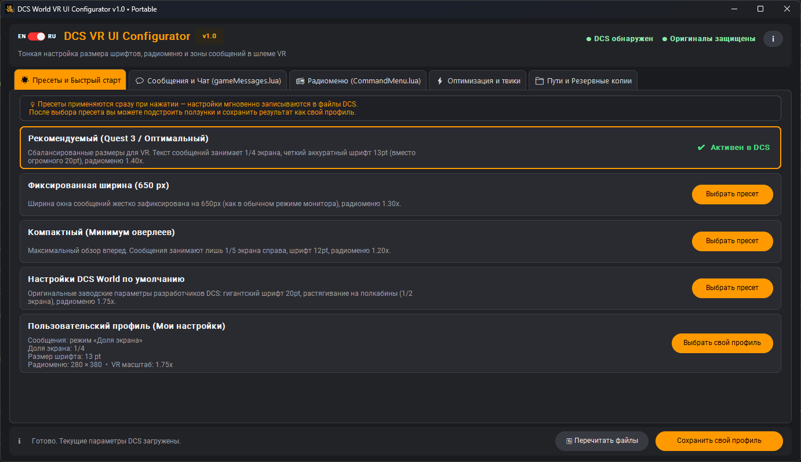

# DCS World VR UI Configurator

[Русский — перейти к русской версии ↓](https://github.com/Hokum-A/dcs-vr-ui-configurator?tab=readme-ov-file#russian)

<a id="english"></a>
##  English

A Windows application for customizing selected parts of the DCS World interface, with a focus on VR. Adjust message and radio menu sizing, choose the VR background scene used by the main menu and F-10 map, and manage supported `autoexec.cfg` tweaks.

## Features

- Presets for message and radio menu settings, plus a custom profile.
- Adjust message width and font size, and radio menu scale and dimensions.
- Choose the VR background scene: DCS original, procedural sky, or a minimal black scene.
- Set the first waypoint of a new route to AGL / RADIO, 1 m; only the two corresponding values in `RouteTool.lua` are changed.
- Manage supported `autoexec.cfg` settings: `DLSS_Preset`, `HUD_MFD_after_DLSS`, `disable_write_track`, `no_device_hotplug`, and `options.graphics.stereo_mode_use_shared_parser`.
- Automatically detect DCS World and Saved Games paths, with an option to change them in the app.

The custom profile stores settings from **Messages & Chat**, **Radio Menu**, the selected VR scene, and the first-waypoint option. When the custom profile or manual settings are active in DCS, saving the profile also applies these settings to the game files. When a built-in preset is active, the profile is saved in the app without changing DCS files. `autoexec.cfg` settings are not included in the profile and are not changed by saving it. Built-in presets configure messages and the radio menu, and restore the preserved original VR scene and settings for the first waypoint DCS creates in a new route, including its altitude and altitude reference. If the original files are unavailable, the preset is not applied.

## Screenshot


### In-game comparison


## Download

Download the [latest Windows x64 release](https://github.com/Hokum-A/dcs-vr-ui-configurator/releases/latest). You can also [browse all releases](https://github.com/Hokum-A/dcs-vr-ui-configurator/releases).

## Run from source (Windows)

Python 3.12 is tested with this project.

1. Open PowerShell in the project folder.
2. Install dependencies:

   ```powershell
   py -3.12 -m pip install -r requirements.txt
   ```

3. Run the application:

   ```powershell
   py -3.12 app.py
   ```

## Build the executable

Install the application dependencies and PyInstaller:

```powershell
py -3.12 -m pip install -r requirements.txt pyinstaller
```

Then build from the project folder:

```powershell
py -3.12 -m PyInstaller --clean --noconfirm dcs_vr_ui_configurator.spec
```

The executable will be created in `dist/`.

## Backups and restoration

- On first launch, the app saves available original DCS files in `backups/original/`. The original `SceneVR.lua` is backed up before the first VR scene change.
- The restore button restores saved originals for supported DCS files. `autoexec.cfg` is not included in this restoration.
- Keep `backups/original/` if you want to use the restore feature.

## License

This project is licensed under the [MIT License](LICENSE).

---

<a id="russian"></a>
##  Русский

[English — перейти к английской версии ↑](https://github.com/Hokum-A/dcs-vr-ui-configurator?tab=readme-ov-file#english)

Программа для Windows, предназначенная для настройки отдельных элементов интерфейса DCS World, в первую очередь в VR. Позволяет менять размеры сообщений и радиоменю, выбирать фоновую VR-сцену главного меню и карты F-10, а также управлять поддерживаемыми параметрами `autoexec.cfg`.

## Возможности

- Пресеты для сообщений и радиоменю, а также сохранение пользовательского профиля.
- Настройка ширины и размера шрифта сообщений, масштаба и размеров радиоменю.
- Выбор фоновой VR-сцены: оригинальная сцена DCS, процедурное небо или минималистичная чёрная сцена.
- Переключение высоты и типа первой точки нового маршрута на AGL / RADIO, 1 м; изменяются только два соответствующих значения в `RouteTool.lua`.
- Управление поддерживаемыми параметрами `autoexec.cfg`: `DLSS_Preset`, `HUD_MFD_after_DLSS`, `disable_write_track`, `no_device_hotplug` и `options.graphics.stereo_mode_use_shared_parser`.
- Автоматическое определение путей к DCS World и папке Saved Games с возможностью изменить их в программе.

Пользовательский профиль сохраняет настройки вкладок **«Сообщения и Чат»**, **«Радиоменю»**, выбранную VR-сцену и параметр первой путевой точки. Если пользовательский профиль или ручные настройки активны в DCS, при сохранении они также применяются к файлам игры. Если активен штатный пресет, профиль сохраняется в программе без изменения файлов DCS. Параметры `autoexec.cfg` в профиль не входят и при сохранении профиля не изменяются. Штатные пресеты настраивают сообщения и радиоменю, а также восстанавливают сохранённые оригинальные настройки VR-сцены и первой точки, которую DCS создаёт при построении нового маршрута, включая её высоту и способ отсчёта. Если оригинальные файлы недоступны, пресет не применяется.

## Скриншот



### Сравнение в игре


## Скачать

Скачайте [последнюю версию для Windows x64](https://github.com/Hokum-A/dcs-vr-ui-configurator/releases/latest). Также доступны [все релизы проекта](https://github.com/Hokum-A/dcs-vr-ui-configurator/releases).

## Запуск из исходников (Windows)

Для проекта проверен Python 3.12.

1. Откройте PowerShell в папке проекта.
2. Установите зависимости:

   ```powershell
   py -3.12 -m pip install -r requirements.txt
   ```

3. Запустите программу:

   ```powershell
   py -3.12 app.py
   ```

## Сборка EXE

Установите зависимости программы и PyInstaller:

```powershell
py -3.12 -m pip install -r requirements.txt pyinstaller
```

Затем выполните команду из папки проекта:

```powershell
py -3.12 -m PyInstaller --clean --noconfirm dcs_vr_ui_configurator.spec
```

Готовый EXE появится в папке `dist/`.

## Резервные копии и восстановление

- При первом запуске программа сохраняет доступные оригинальные файлы DCS в `backups/original/`. Оригинал `SceneVR.lua` сохраняется перед первым переключением VR-сцены.
- Кнопка восстановления возвращает сохранённые оригиналы поддерживаемых файлов DCS. `autoexec.cfg` в это восстановление не входит.
- Не удаляйте `backups/original/`, если хотите пользоваться восстановлением.

## Лицензия

Проект распространяется по лицензии [MIT](LICENSE).
